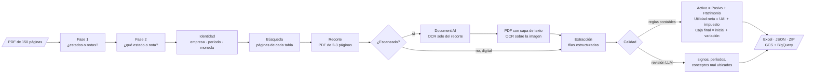
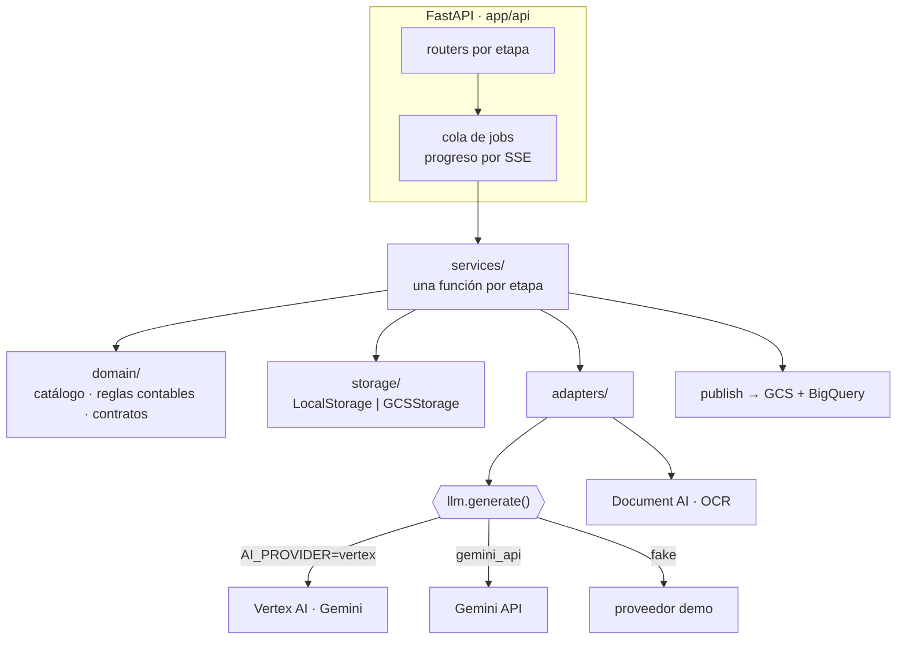

# Document Extraction AI

API que **localiza, extrae y valida tablas dentro de PDFs extensos** con Gemini (Vertex AI) y Document AI, y entrega Excel, JSON y una fila de trazabilidad en BigQuery.

El dominio de ejemplo son los **estados financieros auditados de empresas mineras peruanas** que se publican en la SMV: informes de 80 a 200 páginas donde el balance, el estado de resultados y las notas que importan ocupan diez. El motor no sabe nada de finanzas: todo lo del dominio vive en un catálogo declarativo, en los prompts y en unas reglas contables.

[](https://github.com/Art1217/DATA_EXTRACT/actions/workflows/ci.yml)


---

## Pruébalo en 1 minuto (sin credenciales)

```bash
git clone https://github.com/Art1217/DATA_EXTRACT.git
cd DATA_EXTRACT
docker compose up --build
```

Abre <http://localhost:8000/docs>, sube cualquier PDF en `POST /v1/documents` y lanza `POST /v1/documents/{id}/auto`.

Arranca en **modo demo** (`AI_PROVIDER=fake`): un proveedor determinista responde con los estados de una empresa ficticia, así que se puede recorrer el pipeline completo (clasificación, búsqueda, extracción, control de calidad, Excel y ZIP) sin pagar un token. Para usar Gemini de verdad, ver [Correr con GCP](#correr-con-gcp).

Sin Docker:

```bash
python -m venv .venv && source .venv/bin/activate   # en Windows: .venv\Scripts\activate
pip install -e ".[gcp,dev]"
python -m uvicorn app.main:app --reload
```

---

## Qué hace



| Etapa | Modelo | Por qué es una etapa propia |
|---|---|---|
| **Clasificación** en dos fases | barato (Flash) | La Fase 2 no exige la Fase 1: quien ya sabe qué trae su documento se ahorra una pasada. |
| **Identidad** | barato | Se calcula una vez y la reutilizan todos los análisis; sirve de ancla para no mezclar subsidiarias. |
| **Búsqueda** + **recorte** | barato | Cuanto mejor la búsqueda, menos páginas paga la extracción. El recorte se puede corregir a mano (`POST /cut`). |
| **OCR** (solo escaneados) | Document AI | Va **después** del recorte: se paga el OCR de 2-3 páginas, no de las 150. Su texto se incrusta como capa invisible sobre la imagen, así el modelo recibe un único PDF con lo visual y el texto exacto. Sin `DOCAI_PROCESSOR_ID`, el escaneado va directo al modelo. |
| **Extracción** | caro (Pro) | La etapa cara: chunks con solape, continuidad entre chunks y reparación de JSON dañado para no perder una respuesta ya pagada. |
| **Calidad** | reglas + caro | Primero reglas deterministas (gratis, sin alucinaciones); el modelo solo revisa lo que una suma no ve. |

### El catálogo

| Grupo | Análisis | Extrae | Reglas contables | Revisión LLM |
|---|---|:-:|:-:|:-:|
| Estados | Estado de Situación Financiera | ✓ | ✓ | ✓ |
| Estados | Estado de Resultados | ✓ | ✓ | ✓ |
| Estados | Estado de Flujos de Efectivo | ✓ | ✓ | |
| Estados | Estado de Cambios en el Patrimonio | ✓ | | |
| Notas | Propiedades, Planta y Equipo · Inventarios · Ventas por metal | ✓ | | |
| — | Dictamen del auditor (solo se localiza) | | | |

Agregar un análisis es **una fila** en [`app/domain/analysis.py`](app/domain/analysis.py) y sus prompts en [`prompts/`](prompts/). El servidor no arranca si falta un prompt declarado.

### Abierto a otras áreas

Los estados financieros son el dominio de ejemplo, no un límite. Las etapas, los jobs, el recorte, el OCR, la extracción por chunks y la reparación de JSON no saben nada de finanzas: el dominio vive en el catálogo, los prompts y las reglas. Para sumar un área (informes técnicos, contratos, reportes de laboratorio…):

1. **Un grupo nuevo** en el enum `Group` y su prompt de Fase 2 en `CLASSIFICATION_ANALYSIS_PROMPTS` ([`analysis.py`](app/domain/analysis.py)).
2. **El grupo en la Fase 1**: agregarlo a [`classification/grupo.prompt`](prompts/classification/grupo.prompt) para que se detecte.
3. **Una fila por análisis** en el catálogo, con sus prompts de búsqueda, extracción y, si aplica, calidad.
4. **Reglas deterministas**, opcionales, en [`accounting.py`](app/domain/accounting.py). Sin reglas ni prompt de calidad, el análisis simplemente no tiene esa etapa.

Lo único todavía ligado al dominio financiero es la **identidad**: un solo prompt para todo el documento, con la empresa como ancla de la búsqueda y como columnas del Excel y de BigQuery. Un área cuya ficha sea otra (un pozo, un laboratorio) corre igual, pero esas columnas quedan vacías; el siguiente paso es un perfil de identidad por área.

---

## Arquitectura



Las dependencias van en una sola dirección: `services/` no importa nada de `api/` ni de `jobs/`, así que cada etapa se puede ejecutar desde un script o un test.

### Decisiones de diseño

- **Cada etapa es un endpoint.** Repetir solo lo que falló, corregir un recorte y reextraer sin repetir la búsqueda, o revalidar filas corregidas a mano sin pagar otra extracción (`POST /v1/quality/check`).
- **El `document_id` es el SHA-256 del contenido.** Subir el mismo PDF dos veces devuelve el mismo id y todos sus artefactos ya calculados.
- **Reutilizar es el comportamiento por defecto.** Rehacer una etapa cara es una decisión explícita (`reuse: false`), nunca un accidente. `auto` con `plan_only: true` clasifica sin gastar en extracción.
- **Las reglas contables mandan sobre el modelo.** Un balance que no cuadra se rechaza aunque el LLM lo apruebe, y el error dice cuánto descuadra y en qué período.
- **Un proveedor de IA conmutable.** Los adaptadores arman partes neutras (`text`, `blob`) y llaman a `llm.generate()`. El modo `fake` no importa el SDK de Google: los tests y el demo corren sin red.
- **Storage por claves POSIX.** `documents/<id>/extraction/<análisis>/result.json` es una ruta en disco y, con `STORAGE_BACKEND=gcs`, literalmente el nombre del objeto en el bucket.
- **Techo global de llamadas al modelo.** El paralelismo real es `JOB_WORKERS × BUSQUEDA_WORKERS`; `MAX_CONCURRENT_LLM_CALLS` evita el rate limit.
- **Lo que no puede tumbar un job no lo tumba.** La telemetría, la publicación al bucket o una fila rechazada por BigQuery se registran y el job sigue: la extracción ya está pagada.

---

## Correr con GCP

```bash
gcloud auth application-default login
gcloud services enable aiplatform.googleapis.com documentai.googleapis.com \
    storage.googleapis.com bigquery.googleapis.com
```

`.env` (ver [`.env.example`](.env.example)):

```ini
AI_PROVIDER=vertex
GCP_PROJECT_ID=mi-proyecto

# Opcional: OCR de PDFs escaneados
DOCAI_PROCESSOR_ID=abc123

# Opcional: los artefactos viven en un bucket en vez de en disco
STORAGE_BACKEND=gcs
GCS_BUCKET=mi-bucket

# Opcional: entregables al bucket + una fila por análisis en BigQuery
PUBLISH_ENABLED=true
BIGQUERY_DATASET=document_extraction
```

La tabla de BigQuery se crea sola (particionada por `published_at`) y gana columnas nuevas si el esquema crece. Las filas extraídas viajan en `rows_json`, consultables con SQL:

```sql
SELECT company, fiscal_period,
       JSON_VALUE(fila, '$.concepto') AS concepto,
       CAST(JSON_VALUE(fila, '$.valor') AS NUMERIC) AS valor
FROM `mi-proyecto.document_extraction.extractions`,
     UNNEST(JSON_QUERY_ARRAY(rows_json)) AS fila
WHERE analysis_type = 'resultados'
  AND JSON_VALUE(fila, '$.codigo') = 'UTILIDAD_NETA';
```

Sin un proyecto de GCP también se puede usar un modelo real con una API key de [Google AI Studio](https://aistudio.google.com/): `AI_PROVIDER=gemini_api` y `GEMINI_API_KEY=...`.

---

## Uso de la API

```bash
BASE=http://localhost:8000/v1
DOC=$(curl -s -X POST $BASE/documents -F "file=@eeff-2024.pdf" | jq -r .document_id)

# Todo de una vez: plan + cada análisis detectado + ZIP
curl -s -X POST $BASE/documents/$DOC/auto -H 'Content-Type: application/json' -d '{}'

# O etapa por etapa
curl -s -X POST $BASE/documents/$DOC/plan        -H 'Content-Type: application/json' -d '{}'
curl -s -X POST $BASE/documents/$DOC/pipeline    -H 'Content-Type: application/json' \
     -d '{"analysis_type": "situacion_financiera"}'

# Cada POST devuelve 202 con un job_id; el avance se sigue por polling o SSE
curl -s $BASE/jobs/<job_id>
curl -N $BASE/jobs/<job_id>/events

curl -s $BASE/documents/$DOC/extraction/situacion_financiera/xlsx -o balance.xlsx
```

| | Endpoints principales |
|---|---|
| Documentos | `POST /v1/documents` · `GET /v1/documents/{id}` (con el inventario de etapas ya ejecutadas) |
| Clasificación | `POST .../classification/groups` · `POST .../classification/analysis` · `POST .../plan` |
| Etapas | `POST .../identity` · `.../search` · `.../cut` · `.../extraction` · `.../quality` |
| Compuestos | `POST .../pipeline` · `POST .../auto` · `POST .../bundle` · `POST /v1/bundles` |
| Sin documento | `POST /v1/quality/check` — validar filas corregidas a mano |
| Sistema | `GET /v1/catalog/analysis-types` · `GET /v1/config` · `GET /healthz` |

Con `API_KEY` configurada, todo `/v1` exige la cabecera `X-API-Key`.

---

## Tests

```bash
pytest          # 168 tests, ninguno llama a un modelo real
ruff check .
```

Las pruebas corren con el mismo proveedor `fake` del demo envuelto en un contador, así que ejercitan los adaptadores reales, el parseo de respuestas, los jobs y las rutas HTTP, y pueden afirmar que una etapa **reutilizó** un resultado en vez de volver a pagar por él. `tests/test_adapters.py` baja un nivel más: sustituye solo el cliente de `google-genai` para probar el proveedor de Gemini por dentro.

[`scripts/probar_api.py`](scripts/probar_api.py) recorre la API etapa por etapa contra un servidor encendido, útil para probar con un PDF real.

---

## Estructura

```
app/
  api/        routers, esquemas, errores HTTP, API key
  jobs/       cola en memoria, estado persistido, eventos SSE
  services/   una etapa por módulo + publicación GCS/BigQuery
  domain/     catálogo de análisis, reglas contables, contratos
  storage/    LocalStorage, GCSStorage, claves
  adapters/   proveedor LLM (vertex | gemini_api | fake), Document AI, PyMuPDF/OpenCV
prompts/      clasificación, identidad, búsqueda, extracción y calidad
tests/
```

## Licencia

[MIT](LICENSE)
